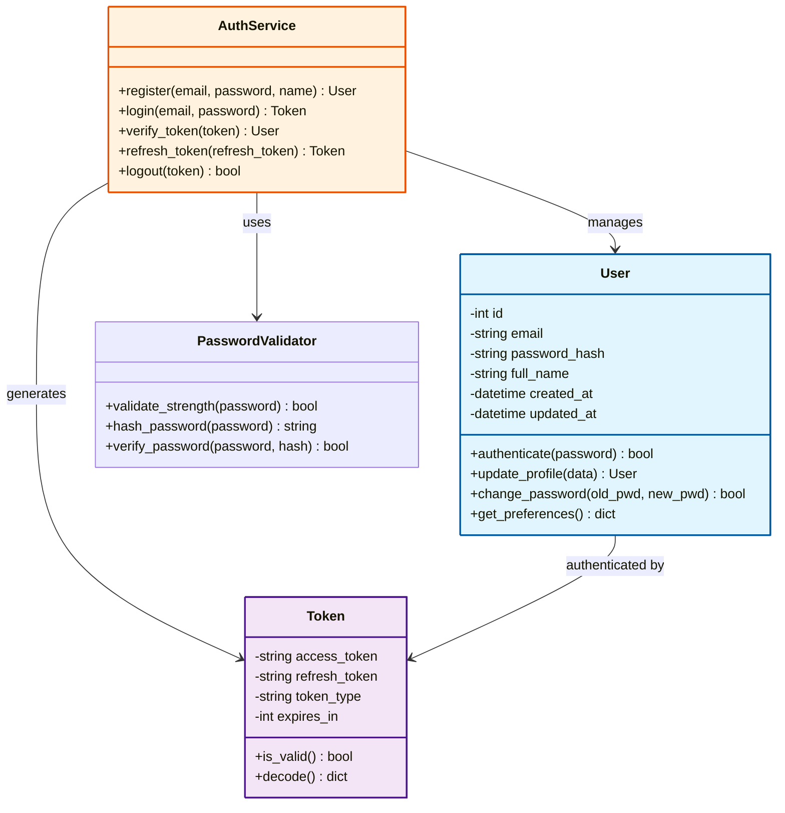
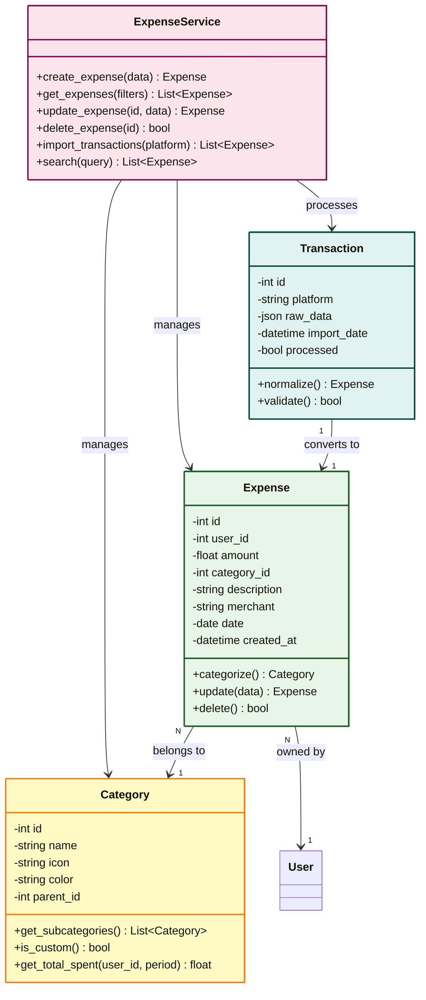
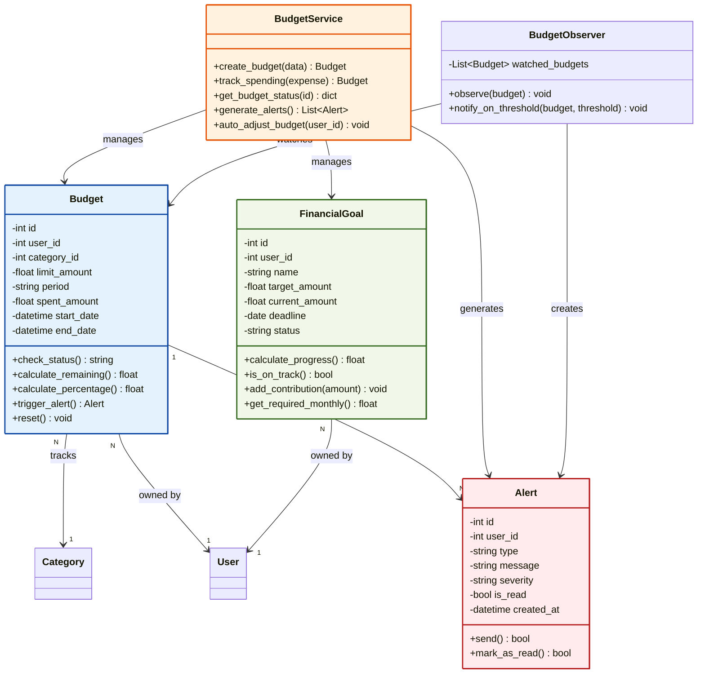
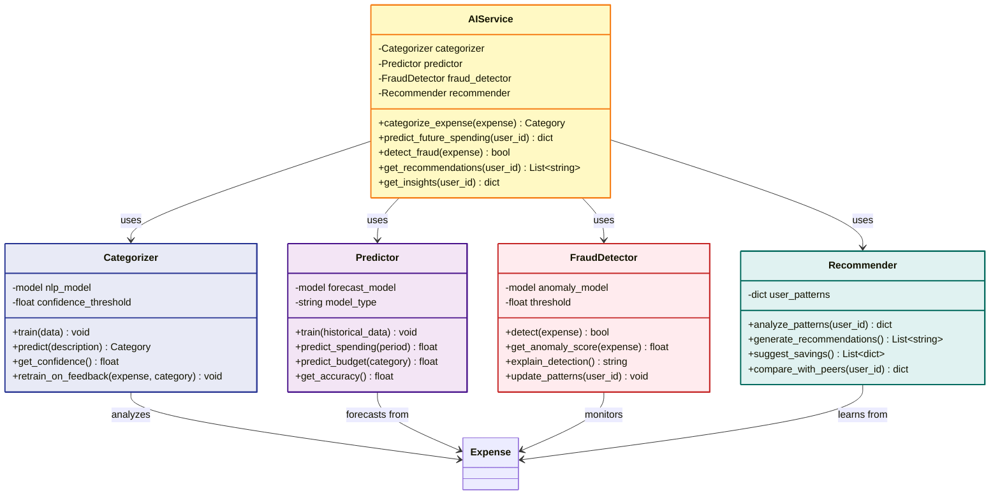
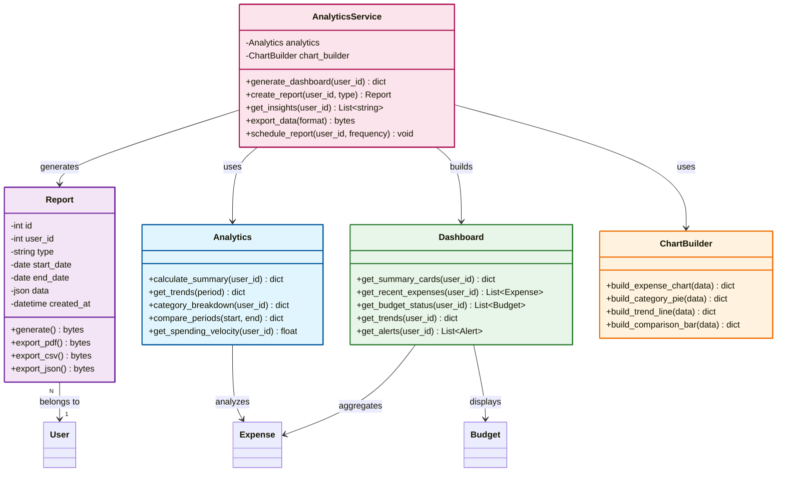
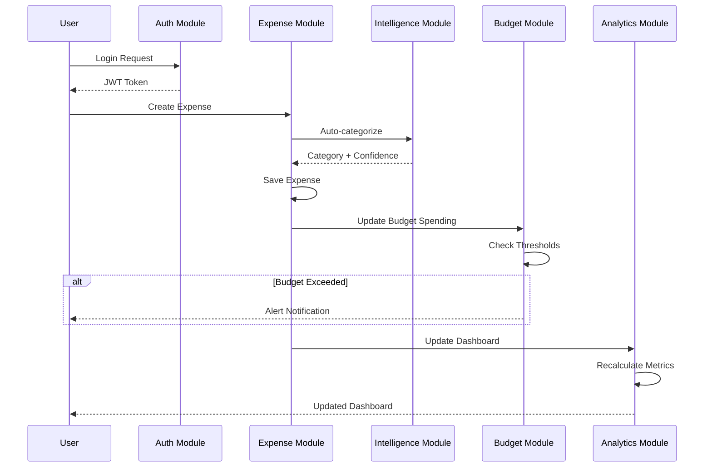
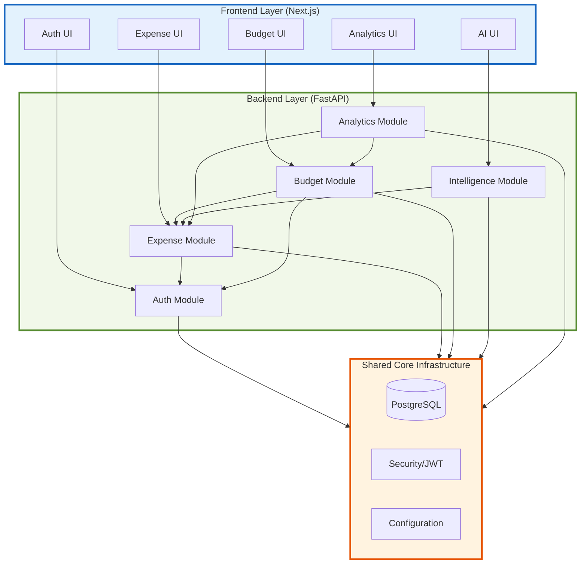

# UML Class Diagrams - 5 Core Modules

> **Generated using Mermaid** - Crisp, clear diagrams for each module

---

## Module 1: Authentication & User Management

### Overview
Handles user identity, security, and session management.

### UML Class Diagram

---

## Module 2: Expense Management

### Overview
Transaction tracking with categorization and multi-platform import.

### UML Class Diagram

---

## Module 3: Budget & Financial Goals

### Overview
Budget planning, monitoring, and goal tracking with alerts.

### UML Class Diagram

---

## Module 4: AI/ML Intelligence Services

### Overview
AI-powered automation for categorization, predictions, and fraud detection.

### UML Class Diagram

---

## Module 5: Analytics & Insights

### Overview
Data visualization, reporting, and trend analysis.

### UML Class Diagram

---

## Module Interaction Sequence

### User Creates Expense Flow

---

## System Architecture Overview

---

## Summary

| Module | Classes | Key Relationships | Primary Function |
|--------|---------|-------------------|------------------|
| **Auth** | User, AuthService, Token | User ↔ Token | Identity & Security |
| **Expense** | Expense, Category, Transaction | Expense → Category | Transaction Tracking |
| **Budget** | Budget, Goal, Alert | Budget → Alert | Budget Monitoring |
| **Intelligence** | Categorizer, Predictor, FraudDetector | AI Services → Expense | AI Automation |
| **Analytics** | Dashboard, Report, Analytics | Analytics → Expense/Budget | Insights & Reports |

**Platform Type**: Single unified web application with modular code organization
